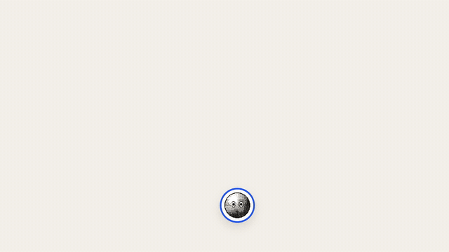
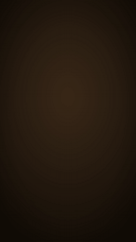

# Content Engine

**Make videos, ads and social designs in code. Arabic-first.**

[](LICENSE)
[](https://www.remotion.dev)


<p align="center">
  
  &nbsp;
  
</p>
<p align="center"><sub>The two examples in this repo, rendered as they are. Left: <code>HelloFilm</code> (format 1). Right: <code>HelloReel916</code> (format 2).</sub></p>

An open engine for making videos in code, built on [Remotion](https://www.remotion.dev) (React). It grew out of a real production studio in Cairo, where it made explainers, ads, footage cuts and social designs for creators and clients. This repository holds the engine only: the shared kit, the tools around it, and two small examples. No client projects, media or keys.

Arabic-first and RTL-ready: Arabic type, word-by-word captions, Egyptian and Gulf copy all work out of the box. It works just as well in English.

**Why use it**

- One spec, two sizes: the same film renders 16:9 for YouTube and 9:16 for Reels, TikTok and Shorts.
- The edit is code: every cut, move, grade and caption is a line you can read, diff and reuse. A new ad starts from the last one.
- Sound is built, not dragged: voice loudness, effects on the beat, music ducked under the voice, mastered in one command.
- AI where it helps: Google image, video, voice and music generation through your own Cloud project, with no API keys stored.
- Arabic done right: real Arabic faces, right-to-left layout, captions that follow the voice word by word.

> **بالعربي:** ده محرك مفتوح المصدر لعمل الفيديوهات بالكود، مبني على Remotion. فيه أدوات المونتاج والموشن والكابشن والصوت وتحليل الفوتيج والتوليد من جوجل، من غير أي مشاريع عملاء أو ملفات أو مفاتيح. ابدأ بالمثالين `HelloReel916` و `HelloFilm`، وحط الفوتيج بتاعك في `public/`.

## What it makes

| Format | Kit | What it is |
| --- | --- | --- |
| 1. Explainer | `src/kit/film.tsx`, `scene.tsx`, `agent.tsx`, `captions.tsx` | A film driven by a voice-over: scenes on the voice's clock, copy that builds line by line, transitions, impacts that shake the frame, a character, captions with one tinted word. One spec renders 16:9 and 9:16. |
| 2. Footage cut | `src/kit/reel.tsx` | A cut of shots: trims, speed and speed ramps, freezes, crops that follow faces, slow moves, colour grades (CSS and tone curves), the way each shot arrives (cut, fade, whip, flash, punch, zoom, slide, glitch, blur, light, burn), text on top, J and L cuts, music, vignette and grain. |
| 3. 3D studio | `src/kit/studio.tsx`, `direct.ts`, `portrait.tsx` | A night studio in real 3D (Three.js) with a character, directed with keyed values and camera presets over story seconds. |
| Design stills | `src/kit/design/` | Posts, carousels, covers and ads from a spec: world (art direction) + archetype (layout) + words + pictures + frame. Brands live in `design/brands.ts`. |
| Effects | `src/kit/fx/` | GPU passes (grades, light rays, glow, transitions) on images and clips. |
| Compositing | `src/kit/depth.tsx`, `screen.tsx`, `phone.tsx` | A camera moving inside a still through its depth map; real footage on a screen inside a take; your own UI on a phone screen tracked through a take. |

Shared pieces: `brand.tsx` (identity: colours, fonts, accents), `layout.tsx` (16:9 and 9:16 with safe margins), `fonts.tsx` (fonts and the gate that holds a frame until they load), `anim.tsx` (clock, springs, words, typing, counters, stamps, cursor), `ui.tsx` (windows, chips), `qa.tsx` (in-page layout checks).

## Quick start

Needs Node 18+ and, for the Python tools, Python 3.10+ with ffmpeg on the PATH.

```bash
npm install
npm run studio                 # open Remotion Studio and play HelloReel916 / HelloFilm
npm run typecheck
npx remotion render src/index.ts HelloReel916 out/hello.mp4
```

On Windows with a GPU, `render.cmd HelloReel916` type-checks, renders, renders the cover next to it if the video has one (`<id>Cover`), and can master the sound (`render.cmd HelloReel916 out\hello.mp4 -14`).

Quick visual checks without a full render:

```bash
node tools/stills.mjs HelloReel916 out/check 0.5 20 95 160
```

## Making a video

1. `node tools/new-video.mjs my-video` scaffolds a format 1 film (`--studio` for format 3) and prints the lines to add to `src/Root.tsx`. For a footage cut, copy `src/videos/hello-reel/` and point the shots at clips under `public/my-video/`.
2. Write the script in `vo/my-video.txt`, make the voice-over (yours, or `tools/gen.mjs voice`), then time the captions with `tools/cues.py`.
3. Build the scenes or shots on the voice's clock. Check frames with `tools/stills.mjs` and layout with `node qa.mjs <id> check`.
4. Build the soundtrack with `python3 tools/audio.py my-video` (voice loudness, effects, music ducked under the voice, limiter) into `public/my-video/mix.wav`, and listen before the full render.
5. Render.

## Tools

| Tool | Does |
| --- | --- |
| `tools/new-video.mjs` | scaffolds a new video and prints its Root lines |
| `tools/stills.mjs` | renders a list of frames as PNGs |
| `qa.mjs` | half-size frames, and a layout check for videos that mount `<QA/>` |
| `tools/gen.mjs` | images, video, voice-over and music with Google models on Vertex AI (see below) |
| `tools/audio.py` | the whole soundtrack of a video from its `sfx-cues.json` |
| `tools/sfx.py` | an effects track from a cue list and `sfx-lib/` |
| `tools/cues.py` | caption timings from a voice-over |
| `tools/beats.py`, `tools/music.py` | beats of a track for cutting on the music; finding and fetching free music (Incompetech, with credits) |
| `tools/footage.py` | measures raw footage (sharpness, clipping, shake, faces), contact sheets, graded and steadied selects |
| `tools/takes.py` | reviews generated takes: sheets, jumps, words against the script (faster-whisper) |
| `tools/qc.py` | checks a finished render (size, fps, length, repeated frames and more) before anyone watches it |
| `tools/depth.py` | depth maps for 2.5D camera moves in stills |
| `tools/cutout.py` | subject cut-outs (rembg) |
| `tools/photo.py`, `contrast.py`, `headroom.py`, `matte_clean.py` | picture fixes: de-plastic generated photos, contrast, reframing, matte cleanup |
| `tools/screen.py`, `tools/phone_*.py` | measure and track screens inside takes for `kit/screen.tsx` and `kit/phone.tsx` |
| `tools/design_sfx.py`, `tools/carousel_sfx.py` | sound for moving designs and carousels |
| `tools/render-parts.sh`, `tools/export-set.sh` | resumable render in parts (headless servers); export a set of stills |

Python packages: `pip install -r requirements.txt` (the optional ones are only needed by the tool named next to them).

## Media you bring

Nothing below is in git (see `.gitignore`); each folder is yours to fill:

- `public/<video>/` the footage, stills and `mix.wav` a video plays
- `vo/` scripts and voice-overs, `music/` music beds, `sfx-lib/` sound effects (`tools/sfx.py` reads `sfx-lib/pro/`, `sfx-lib/uisfx/`, `sfx-lib/kenney/` and `sfx-lib/youtube/`; free CC0 packs such as Kenney's work well)
- `public/fonts/` self-hosted fonts. Most faces come from `@fontsource` packages and install with npm. A few display faces in `kit/design/fontshare.ts` are Fontshare fonts whose licence forbids redistribution: download them yourself from fontshare.com if you use them. `docs/fonts.md` lists the licences.

## Google generation (optional)

`tools/gen.mjs` calls Google models on Vertex AI (Gemini images, Omni video, Gemini TTS voice-over, Lyria music). It stores no API keys: it asks `gcloud` for a short-lived token and bills your own Google Cloud project.

1. Copy `.env.example` to `.env` and set `GOOGLE_CLOUD_PROJECT`.
2. On Windows run `setup-google.cmd` once; elsewhere run `gcloud auth application-default login` and `gcloud auth application-default set-quota-project <project>`.
3. `node tools/gen.mjs image "a paper boat on a desk" --size 1K`. Batches: `node tools/gen.mjs batch jobs.json` (the format is at the top of the file).

## Depth stills

`tools/depth.py` writes `<image>.depth.png` next to a still; a shot with `cam: { dolly, x, y, zoom, focal }` then moves the camera inside the picture (`kit/depth.tsx`). Keep moves small: bigger ones tear at object edges.

## Docs

- `docs/design-system.md` how the design stills are built (worlds, archetypes, type scale, devices)
- `docs/motion-book.md` how the films move and which part of the kit does it
- `docs/fonts.md` font sources and their licences

## Credits

- Built on [Remotion](https://www.remotion.dev). Remotion has its own licence: free for individuals and small teams, a company licence for larger companies. Check [remotion.dev/license](https://www.remotion.dev/license) before commercial use.
- `src/kit/fx/shaders.ts` ports shader code from ArtCraft's EffectCraft and LightCraft (Apache-2.0), see `src/kit/fx/NOTICE.md`.
- `tools/models/face_yunet.onnx` is YuNet from the OpenCV Model Zoo, see `tools/models/NOTICE.md`.

## Licence

MIT, see `LICENSE`. The licence covers this code only, not Remotion or the fonts and models it uses, which keep their own licences.
